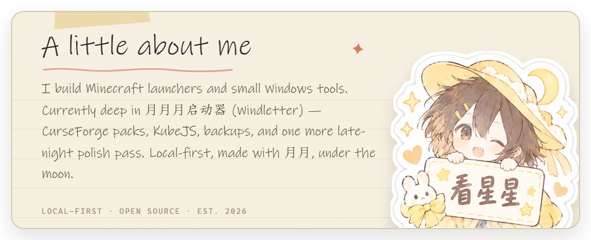
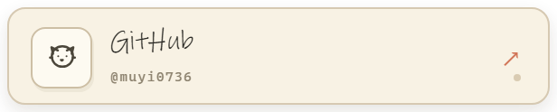
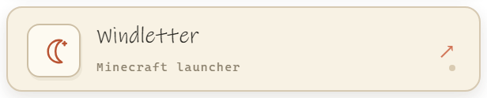
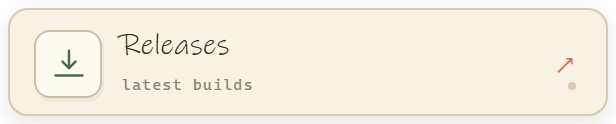
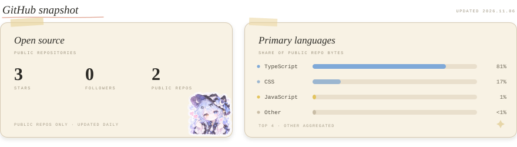

  

 
 

 

  

  <a href="https://github.com/muyi0736">GitHub</a> · <a href="https://github.com/muyi0736/windletter">Windletter</a> · <a href="https://github.com/muyi0736/windletter/releases">Releases</a> · 易易 &amp; 月月, under the moon

<!-- The snapshot card is refreshed daily by .github/workflows/update-profile.yml -->
